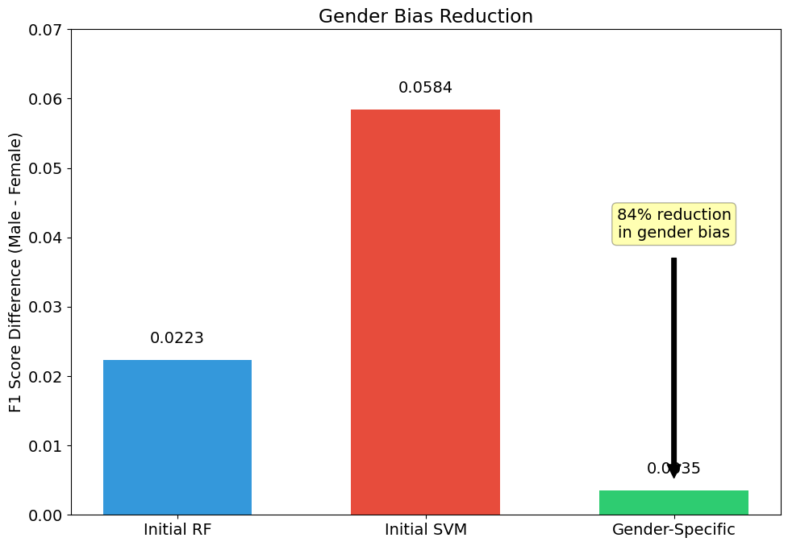
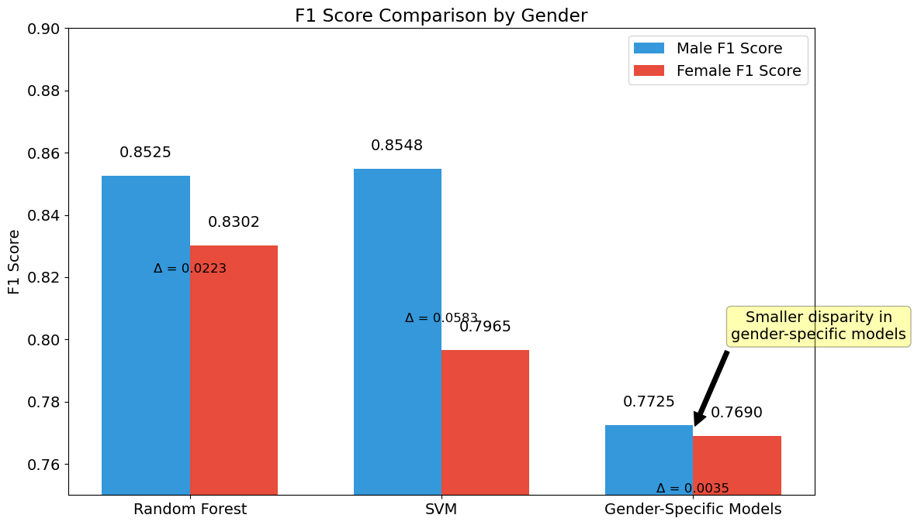
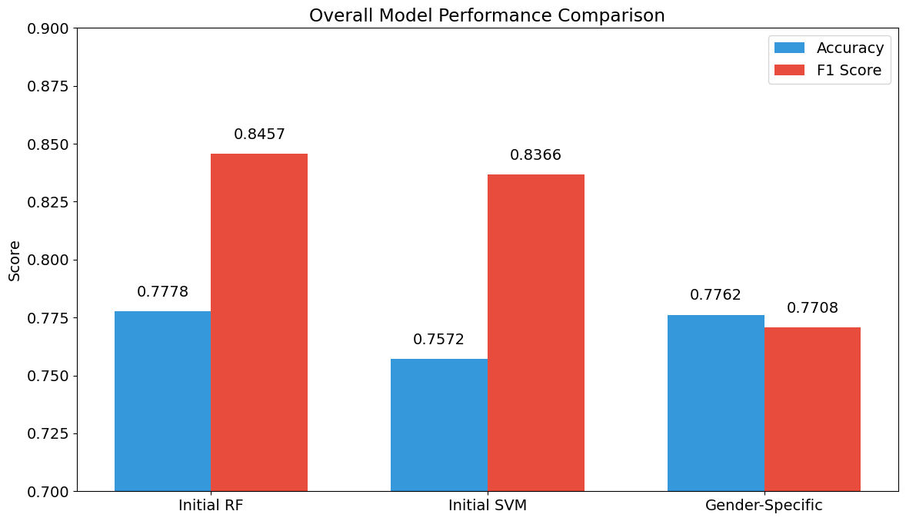
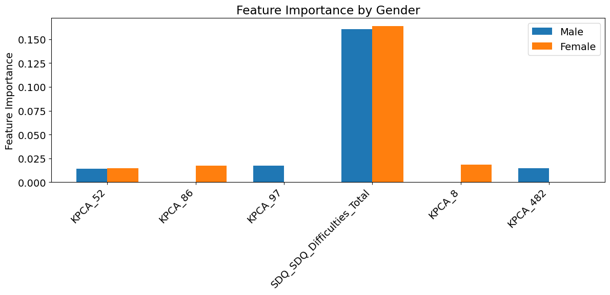

# Gender-Aware ADHD Prediction

A machine learning support tool that predicts ADHD diagnosis in children and adolescents from fMRI brain connectivity and questionnaire data, designed to perform **equally well for girls and boys**.

Girls with ADHD are often underdiagnosed, so a model that works well "on average" can still fail the patients who need it most. This project measures that gap directly and reduces it by **84%**, while keeping every prediction explainable with LIME.

  

---

## Key Results

| Model | Accuracy | F1 | Male F1 | Female F1 | Male vs Female F1 gap |
|---|---|---|---|---|---|
| Random Forest (one model for everyone) | 77.8% | 0.846 | 0.853 | 0.830 | 0.022 |
| SVM (one model for everyone) | 75.7% | 0.837 | 0.855 | 0.797 | 0.058 |
| **Gender-specific Random Forests** | **77.6%** | **0.771** | **0.773** | **0.769** | **0.004** |

All results are on a held-out test set of 243 participants (160 male, 83 female). The gender-specific row averages the male model on male test data and the female model on female test data.

- **84% reduction in gender bias:** the gap in F1 score between male and female patients fell from 0.022 to 0.004.
- **Similar accuracy for both sexes:** 78.1% for the male model and 77.1% for the female model.
- **Strong ranking ability:** the unified Random Forest reached an ROC AUC of 0.82 for male and 0.84 for female patients.

<p align="center">
  
  
</p>

---

## The Problem

The project is framed as a data science task for the NHS: build a system that helps GPs diagnose ADHD in children and adolescents, freeing up doctors' time. It had three requirements:

1. **Predict both ADHD diagnosis and sex** from brain imaging and questionnaire data.
2. **Avoid bias against female patients**, who are harder to diagnose with traditional methods.
3. **Be explainable**, to meet GDPR requirements for automated decisions.

## Data

The dataset covers **1,213 children and adolescents** and combines:

- **Functional connectome matrices** from fMRI scans: 19,900 features per participant, describing the connectivity between pairs of brain regions.
- **Socio-demographic data**, such as age at scan and ethnicity.
- **Emotional and behavioural questionnaires**, including the Strengths and Difficulties Questionnaire (SDQ).
- **Parenting questionnaires**, including the Alabama Parenting Questionnaire (APQ).

The data was provided through the CE888 Data Science module at the University of Essex and comes from the [WiDS Datathon 2025](https://www.widsworldwide.org/), based on the Healthy Brain Network study by the Child Mind Institute. **The dataset is not included in this repository.**

---

## Approach

### 1. Leakage-safe preprocessing
- The data is **split 80/20 before any preprocessing**, stratified on sex and ADHD diagnosis together, so the test set is never seen while fitting imputers, scalers or PCA.
- Missing age values (292 in training) are filled with an `IterativeImputer` fitted on the training data only. Missing ethnicity values are set to the "unknown" category.
- **4 features with correlation above 0.8** are removed to reduce redundancy.
- Numerical features are standardised with a scaler fitted on the training data.

### 2. Dimensionality reduction
- With 19,900 connectome features and only 970 training participants, the model would overfit badly on the raw data.
- **Kernel PCA with an RBF kernel** reduces the connectome to 600 components, capturing non-linear patterns in brain connectivity.

### 3. Modelling
- **Random Forest**, tuned with `RandomizedSearchCV` (30 candidates, 5-fold stratified cross-validation, weighted F1).
- **Support Vector Machine**, tuned with `GridSearchCV` over linear, RBF and polynomial kernels (5-fold cross-validation, F1).
- Separate models are trained for **ADHD diagnosis** and for **sex**.

### 4. Measuring and reducing bias
- Bias is measured as the **difference in F1 score between male and female patients** on the test set.
- **T-tests** identify 8 features whose distributions differ significantly between males and females (p < 0.05), mostly parenting and SDQ scores.
- These features are removed, and **separate Random Forest models are trained for male and female patients**, each with its own hyperparameter tuning.

### 5. Explainability
- **LIME** explains individual predictions for both male and female patients.
- For both sexes, the **SDQ Total Difficulties score** is by far the strongest driver of the prediction, followed by a small number of connectome components.

<p align="center">
  
  
</p>

---

## Limitations

These are the points I would raise before any clinical use:

- **Fairness came at a cost in F1.** The gender-specific models are much fairer, but their F1 (0.77) is lower than the unified Random Forest (0.85). For a tool where girls are underdiagnosed, I judged equal performance across sexes to be worth this trade-off, but it is a decision clinicians should make with full information.
- **Small female test set.** Only 83 female participants were in the test set, so the measured gap could change with a different split. Repeated cross-validation would give a more reliable estimate.
- **Non-ADHD cases are harder to detect.** The dataset has about twice as many ADHD cases as non-ADHD cases, and the unified Random Forest correctly identifies only 54% of non-ADHD participants. In practice this would mean false positives.
- **Sex prediction was weak.** The best sex classifier reached only 56% accuracy, which suggests these features carry little sex-specific signal. Its decision threshold was also tuned on the test set, so even that figure is optimistic.
- **Brain explanations are hard to interpret.** LIME highlights Kernel PCA components, which do not map back to specific brain regions, so they are not meaningful to a doctor. Linear PCA or region-level features would make the explanations more useful clinically.
- **Not clinically validated.** The model was trained and tested on a single study's data and would need external validation before use with real patients.

## Future Work

- Use repeated stratified cross-validation to report results with confidence intervals.
- Compare bias-mitigation methods such as reweighting or fairness constraints against separate models.
- Replace Kernel PCA with interpretable, region-level connectivity features.
- Try gradient boosting models (XGBoost, LightGBM) and calibrated probabilities.

---

## Repository Structure

```
gender-aware-adhd-prediction/
├── ADHD_final.ipynb      # Exploration, preprocessing, Kernel PCA, Random Forest and SVM training
├── Model_Eval.ipynb      # Test set evaluation, per-gender metrics and ROC curves
├── gender bias.ipynb     # Bias mitigation, gender-specific models and LIME explanations
├── figures/              # Charts used in this README
└── README.md
```

## How to Run

1. Clone the repository:
   ```bash
   git clone https://github.com/Manas-Acharya/gender-aware-adhd-prediction.git
   cd gender-aware-adhd-prediction
   ```
2. Install the dependencies:
   ```bash
   pip install pandas numpy scipy scikit-learn matplotlib seaborn lime shap openpyxl jupyter
   ```
3. Create a folder named `Data` and place the dataset files in it:
   - `METADATA_A.xlsx`
   - `METADATA_B.xlsx`
   - `LABELS.xlsx`
   - `FUNCTIONAL_CONNECTOME_MATRICES.csv`
4. Run the notebooks in this order. Each one saves models and processed data as `.pkl` files that the next one loads.
   1. `ADHD_final.ipynb`
   2. `Model_Eval.ipynb`
   3. `gender bias.ipynb`

## Tech Stack

Python, pandas, NumPy, scikit-learn, SciPy, LIME, Matplotlib, seaborn, Jupyter
